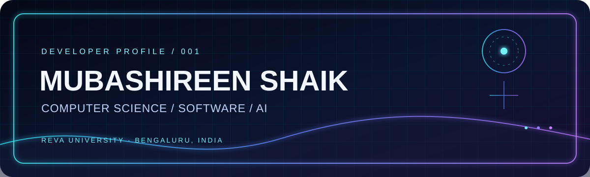
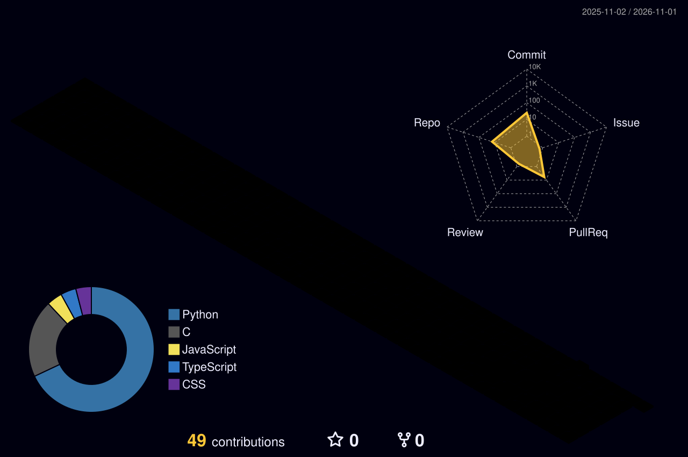
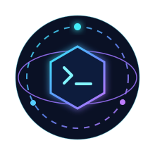

<picture>
  <source media="(prefers-color-scheme: dark)" srcset="assets/holographic-banner.svg">
  <source media="(prefers-color-scheme: light)" srcset="assets/developer-graphics.svg">
  
</picture>

<h1>Hi, I'm Mubashireen Shaik</h1>

  
  
  

---

## About me

I’m a **B.Tech Computer Science and Engineering student at REVA University, Bengaluru, India**. I enjoy programming, working through data structures and algorithms, and building software with other people.

- Exploring **AI/ML** and **web development**.
- Learning by building practical, real-world software.
- Interested in hackathons, collaborative projects, and thoughtful problem-solving.

## Technology stack

<strong>Programming languages</strong>

<strong>Frontend</strong>

<strong>Backend</strong>

<strong>Database</strong>

<strong>Tools</strong>

## Featured projects

| Project | Overview | Technology stack |
| --- | --- | --- |
| [SIH Compliance Checker](https://github.com/Mubashireengaffarmiya/SIH_PROJECT) | **SMART-LM**, an inspection-assistance system for checking packaged-product labels against Legal Metrology declarations. | Python, TypeScript, React, FastAPI, SQLite |
| [Velora AccessGuard](https://github.com/Mubashireengaffarmiya/velora-accessguard_aws_hackathon) | An AI-assisted SaaS access-risk and permission-drift detection project. | Python, JavaScript, HTML, CSS, AWS |
| [2D Graphics Project](https://github.com/Mubashireengaffarmiya/2D-Graphics-Project) | A C-based 2D graphics project. | C |
| [2D Graphics Editor](https://github.com/Mubashireengaffarmiya/2D-Graphics-editor) | A console-based C graphics editor for creating and managing basic shapes. | C, GCC / MinGW |
| [LeetCode Solutions](https://github.com/Mubashireengaffarmiya/leetcode-solutions) | Java solutions to selected problems covering arrays and strings, algorithms, stacks, and linked lists. | Java |

## GitHub activity

 

### 3D contribution calendar

The daily workflow creates the 3D contribution calendar in this profile repository. Run it once from the **Actions** tab to publish the first image.

  

### Contribution snake

The snake workflow publishes light and dark SVGs to the `output` branch. Run it once from the **Actions** tab to publish the first images.

  <picture>
    <source media="(prefers-color-scheme: dark)" srcset="https://raw.githubusercontent.com/Mubashireengaffarmiya/Mubashireengaffarmiya/output/github-contribution-grid-snake-dark.svg">
    <source media="(prefers-color-scheme: light)" srcset="https://raw.githubusercontent.com/Mubashireengaffarmiya/Mubashireengaffarmiya/output/github-contribution-grid-snake.svg">
    
  </picture>

## MUBASHIREEN AI ASSISTANT

### A future-facing guide to my developer profile

The planned assistant will help visitors explore my background, education, skills, projects, repositories, and contact links. A real chatbot or voice assistant does **not** run inside a GitHub README; this section is a visual introduction for a separately hosted application.

[Open the assistant launch page (placeholder)](https://mubashireen-dev.vercel.app/)

This currently opens my portfolio. The standalone AI assistant is not connected yet.

## Connect

- [GitHub](https://github.com/Mubashireengaffarmiya)
- [LinkedIn](https://www.linkedin.com/in/mubashireen-shaik-9784a33a8/)
- [Portfolio](https://mubashireen-dev.vercel.app/)

Built with curiosity, code, and a little holographic glow.

